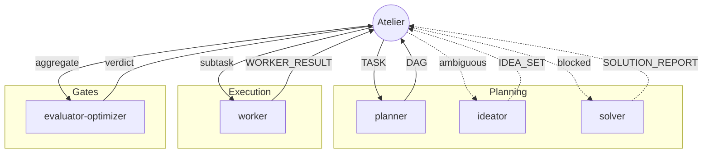

# Atelier

[](./LICENSE)

> An OpenCode V2 project scaffold: a supervisor agent, five subagents, slash
> commands, and skills ready to clone and adapt. No application code.

## Requirements

- [OpenCode](https://opencode.ai) V2 installed.
- No runtime dependencies: everything lives in this repository, with no global
  `~/.config/opencode` requirements.

## Installation

- Clone or copy this repository and open OpenCode inside it: everything is
  discovered from `.opencode/` — there is nothing to build or install.
- Global install (optional): copy **all** `.md` files from `.opencode/agents/`
  to `~/.config/opencode/agents/` so the toolkit works in any project. Copying
  only `atelier.md` is not enough — it dispatches to the other agents.
  Optionally copy `.opencode/commands/` to `~/.config/opencode/commands/`,
  `.opencode/skills/ai-docs/` to `~/.config/opencode/skills/`, and set
  `"default_agent": "atelier"` in the global
  `~/.config/opencode/opencode.json`.

## Configuration

`opencode.json` sets the project defaults:

- `model` — default model for agents that do not pin one; currently
  `opencode-go/deepseek-v4.1-flash`.
- `default_agent` — interactive agent started by default; currently `atelier`.

Atelier deliberately sets no `subagent_depth`. It uses the default depth of 1:
`atelier` launches `planner`, `worker`, and `evaluator-optimizer` directly, and
none of them launches another subagent. The pipeline therefore needs no nested
dispatch and no experimental flags.

`/setup` rewrites `opencode.json` with `$schema`, `model`, and `default_agent`.
OpenCode reloads configuration, agents, commands, and skills automatically; run
`opencode reload` only if a change does not appear.

### Test output

`tool_output` caps every tool result to 120 lines / 16 KiB. Run tests through
`scripts/test-summary.sh`: it writes the full log to `.test-output/` and prints
only a short summary. The `verification` skill defines the reporting rules.

## Usage

- Start here: `atelier` is the default primary agent (supervisor mode). It
  plans, delegates, evaluates, and decides, and never edits files or runs
  commands itself. Press Tab to switch to `build` for hands-on work.
- Choose the project default model: run `/setup`.
- Validate a result: invoke the `evaluator-optimizer` subagent with the
  `subagent` tool (`agent`, `description`, `prompt`) and `TASK:`, `RESULT:`,
  plus optional `CRITERIA:`. It returns a JSON verdict and an improved result
  when it fails.
- Plan a multi-deliverable request: `atelier` triages it. Clear work goes to
  `planner`; ambiguous work goes to `ideator`, then `evaluator-optimizer`
  (`MODE=plan`, 0.6), then `planner`; a blocked technical unknown goes to
  `solver`, then `planner`.
- Research a blocker: invoke `solver` with `PROBLEM`, `CONTEXT`, `WHAT_TRIED`,
  `CONSTRAINTS`, and an optional `BUDGET`; it returns SOURCE-backed
  SOLUTION_REPORT JSON.
- Execute one subtask: invoke the `worker` subagent with a self-contained
  prompt (`TASK:`, `INPUTS:`, `EXPECTED_OUTPUT:`); it returns a JSON result.
- Execute a plan: for a multi-deliverable request, `atelier` invokes the
  planner, validates the DAG, launches independent workers in parallel, retries
  a failed subtask once, skips dependents of a failed subtask, and runs the
  evaluator gate on the final aggregate.
- Run tests without flooding the conversation: `bash scripts/test-summary.sh
  <command>`.
- Verify the pipeline: run `/smoke`; it exercises planner, worker, and
  evaluator and validates the three JSON contracts.
- Plan a hackathon or rapid project: run `/hackathon setup`; it reads the
  brief, writes `docs/hackathon/PRD-ANALYSIS.md`, `PRD.md`, and `PLAN.md`, and
  stops at an approval gate.
- Build the approved MVP: run `/hackathon build`; it autonomously executes only
  `Base + Requisitos` tasks from `docs/hackathon/PLAN.md` with per-task
  verification and writes `BUILD.md`.

Subagents always run in background child sessions: a `subagent` call returns a
`sessionID` immediately and the result arrives later as a `<subagent>` message.
`atelier` records which session belongs to which subtask and continues when the
report arrives.

## Architecture



`atelier` is the only long-lived session. It asks the planner for a DAG,
launches independent workers in parallel, collects their reports across turns,
and sends the aggregate to the evaluator gate. The subagents do the work, but
`atelier` is the hub: every specialist returns to it, and it keeps context small
by working from reports rather than raw outputs.

V2 already runs subagents in background child sessions, so a separate
orchestrator agent would duplicate that layer and need nested dispatch. Atelier
schedules the DAG itself at the default depth, with no experimental flags.

### Planning loop

`atelier` triages multi-deliverable work:

- Clear: `planner` directly.
- Ambiguous: `ideator` generates options, `evaluator-optimizer` gates them with
  `MODE=plan` and a 60% threshold, then `planner` formalizes the approved idea.
- Blocked: `solver` researches the blocker with sources, then `planner`
  formalizes the solution.

`evaluator-optimizer` separates `HARD_CRITERIA` (all must pass) from
`CRITERIA` (soft, scored against the threshold). The final gate uses
`MODE=final` and an 80% threshold plus acceptance evidence.
`atelier` orchestrates these specialists; the planner never launches subagents.

## Project structure

```text
Atelier/
├─ README.md
├─ AGENTS.md
├─ opencode.json
├─ LICENSE
├─ .gitignore
├─ scripts/
│  └─ test-summary.sh
└─ .opencode/
   ├─ agents/
   │  ├─ atelier.md
   │  ├─ evaluator-optimizer.md
   │  ├─ ideator.md
   │  ├─ planner.md
   │  ├─ solver.md
   │  └─ worker.md
   ├─ commands/
   │  ├─ setup.md
   │  ├─ smoke.md
   │  └─ hackathon.md
   └─ skills/
      ├─ ai-docs/
      │  ├─ SKILL.md
      │  └─ README-TEMPLATE.md
      ├─ verification/
      │  └─ SKILL.md
      └─ hackathon/
         ├─ RULES.md
         ├─ README.md
         ├─ hackathon-intake/SKILL.md
         ├─ hackathon-prd-transformer/SKILL.md
         ├─ hackathon-mvp-planner/SKILL.md
         ├─ hackathon-gate/SKILL.md
         └─ hackathon-build/SKILL.md
```

## Project status

Early scaffold: configuration only, no application code. Project scope is
still to be defined.

## License

This project is distributed under the MIT license (see
[LICENSE](./LICENSE)).
