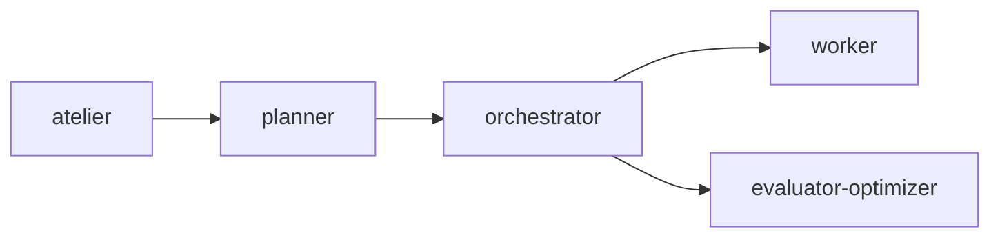

# Atelier

[](./LICENSE)

> An OpenCode project scaffold: project config, agents, commands, and skills
> ready to clone and adapt. No application code yet.

## Requirements

- [opencode](https://opencode.ai) installed.
- No runtime dependencies: everything lives in this repository, with no global
  `~/.config/opencode` requirements.

## Installation

- Clone or copy this repository and open opencode inside it: everything is
  discovered from `.opencode/` — there is nothing to build or install.
- Global install (optional): copy **all** `.md` files from `.opencode/agents/`
  to `~/.config/opencode/agents/` so the toolkit works in any project. Copying
  only `atelier.md` is not enough — it dispatches to the other agents.
  Optionally copy `.opencode/skills/ai-docs/` to `~/.config/opencode/skills/`
  and set `"default_agent": "atelier"` in the global
  `~/.config/opencode/opencode.json`.

## Configuration

`opencode.json` sets the project defaults:

- `model` — default model for agents that do not pin one; currently
  `opencode-go/deepseek-v4.1-flash`.
- `subagent_depth` — maximum nested dispatch depth; `1` forbids nested
  dispatch, `2` (current) enables planner → orchestrator → worker.
- `default_agent` — interactive agent started by default; currently `atelier`.

Note: `/setup` rewrites `opencode.json` with `$schema`, `model`, and
`subagent_depth` only; restore `"default_agent": "atelier"` afterwards.

## Usage

- Start here: `atelier` is the default primary agent (supervisor mode): it
  plans, delegates, evaluates, and decides, and never edits files or runs
  commands itself. Press Tab to switch to `build` for hands-on work.
- Choose the project default model and subagent depth: run `/setup`. It writes
  `opencode.json` (depth `2` enables the orchestrator, at higher consumption).
- Validate a result: invoke the `evaluator-optimizer` subagent via the Task
  tool with `TASK:`, `RESULT:`, and optional `CRITERIA:`.
- Plan a multi-deliverable request: invoke the `planner` subagent with `TASK:`
  plus optional `CONTEXT:`/`CONSTRAINTS:`; it returns a JSON DAG of subtasks.
- Execute one subtask: invoke the `worker` subagent with a self-contained
  prompt (`TASK:`, `INPUTS:`, `EXPECTED_OUTPUT:`); it returns a JSON result.
  The orchestrator prefers it for execution.
- Execute a plan: invoke the `orchestrator` subagent with `PLAN:` (the planner
  JSON) plus optional `CONTEXT:`/`AVAILABLE_AGENTS:`; it dispatches subtasks
  and returns a JSON execution report. Requires `subagent_depth: 2` in
  `opencode.json` (already set) so nested dispatch is allowed.
- Verify the pipeline: run `/smoke` after restarting opencode; it exercises
  planner → orchestrator and validates both JSON contracts.
- Restart opencode after changing `opencode.json`, agents, commands, or
  skills: config is loaded once at startup.

## Architecture



The supervisor pipeline for multi-deliverable work: the planner returns a DAG,
the orchestrator dispatches workers, and the evaluator gates the aggregate.

## Project structure

```text
Atelier/
├─ README.md
├─ AGENTS.md
├─ opencode.json
├─ LICENSE
├─ .gitignore
└─ .opencode/
   ├─ agents/
   │  ├─ atelier.md
   │  ├─ evaluator-optimizer.md
   │  ├─ orchestrator.md
   │  ├─ planner.md
   │  └─ worker.md
   ├─ command/
   │  ├─ setup.md
   │  └─ smoke.md
   └─ skills/
      └─ ai-docs/
         ├─ SKILL.md
         └─ README-TEMPLATE.md
```

## Project status

Early scaffold: configuration only, no application code. Project scope is
still to be defined.

## License

This project is distributed under the MIT license (see
[LICENSE](./LICENSE)).
